<!-- Generated by scripts/render.py. Edit the script, not this file. -->

<a href="https://ldatuan.com"><picture><source media="(prefers-color-scheme: dark)" srcset="./assets/hero-dark.svg"></picture></a>
<picture><source media="(prefers-color-scheme: dark)" srcset="./assets/work-dark.svg"></picture>
<a href="https://github.com/LDATuan/RevitAPI-Learning"><picture><source media="(prefers-color-scheme: dark)" srcset="./assets/card-revitapi-learning-dark.svg">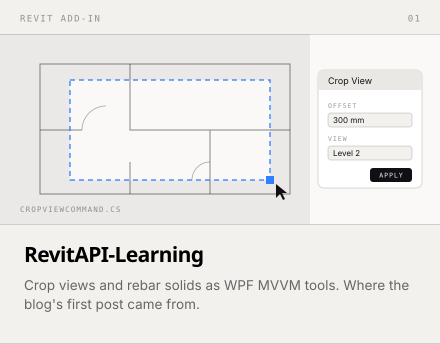</picture></a><a href="https://github.com/LDATuan/AutoCadRebar"><picture><source media="(prefers-color-scheme: dark)" srcset="./assets/card-autocadrebar-dark.svg"></picture></a>
<a href="https://github.com/LDATuan/multiversion-same-assembly"><picture><source media="(prefers-color-scheme: dark)" srcset="./assets/card-multiversion-dark.svg"></picture></a><a href="https://ldatuan.com/about"><picture><source media="(prefers-color-scheme: dark)" srcset="./assets/card-revit-agent-dark.svg"></picture></a>
<a href="https://ldatuan.com/about"><picture><source media="(prefers-color-scheme: dark)" srcset="./assets/card-agent-drawing-dark.svg"></picture></a><a href="https://github.com/LDATuan/pothole"><picture><source media="(prefers-color-scheme: dark)" srcset="./assets/card-pothole-dark.svg"></picture></a>
<picture><source media="(prefers-color-scheme: dark)" srcset="./assets/journey-dark.svg"></picture>
<picture><source media="(prefers-color-scheme: dark)" srcset="./assets/writing-dark.svg"></picture>
<a href="https://ldatuan.com/article/rlhf-and-ppo"><picture><source media="(prefers-color-scheme: dark)" srcset="./assets/post-rlhf-dark.svg"></picture></a><a href="https://ldatuan.com/article/math-foundations-for-machine-learning"><picture><source media="(prefers-color-scheme: dark)" srcset="./assets/post-math-dark.svg">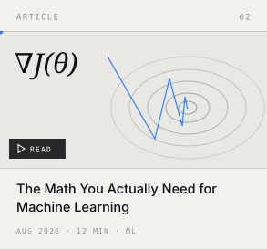</picture></a><a href="https://ldatuan.com/article/how-to-crop-view-with-revitapi"><picture><source media="(prefers-color-scheme: dark)" srcset="./assets/post-crop-view-dark.svg">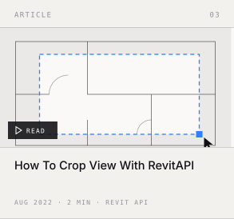</picture></a>
<a href="https://github.com/LDATuan?tab=overview"><picture><source media="(prefers-color-scheme: dark)" srcset="./assets/activity-dark.svg"></picture></a>
<a href="https://ldatuan.com"><picture><source media="(prefers-color-scheme: dark)" srcset="./assets/cta-top-dark.svg"></picture></a>
<a href="https://ldatuan.com"><picture><source media="(prefers-color-scheme: dark)" srcset="./assets/cta-left-dark.svg"></picture></a><a href="https://ldatuan.com"><picture><source media="(prefers-color-scheme: dark)" srcset="./assets/cta-blog-dark.svg"></picture></a><a href="https://www.linkedin.com/in/tuanle-97/"><picture><source media="(prefers-color-scheme: dark)" srcset="./assets/cta-linkedin-dark.svg"></picture></a><a href="https://www.linkedin.com/in/tuanle-97/"><picture><source media="(prefers-color-scheme: dark)" srcset="./assets/cta-right-dark.svg"></picture></a>
<a href="https://ldatuan.com"><picture><source media="(prefers-color-scheme: dark)" srcset="./assets/cta-bottom-dark.svg"></picture></a>

How this page is made

 

Every image here is an SVG drawn by [`scripts/render.py`](scripts/render.py). There is no JavaScript and no image service: motion is CSS keyframes, and the fonts (Archivo, Instrument Serif, Geist Mono and Inter, all under the SIL Open Font License) are subset to the characters each image uses and embedded. Each image has a light and a dark version, picked by your GitHub theme, and everything rests on its final frame when reduced motion is on.

The activity city is redrawn every night by a [GitHub Action](.github/workflows/refresh-profile.yml) that reads the public contribution calendar and commits the result.

